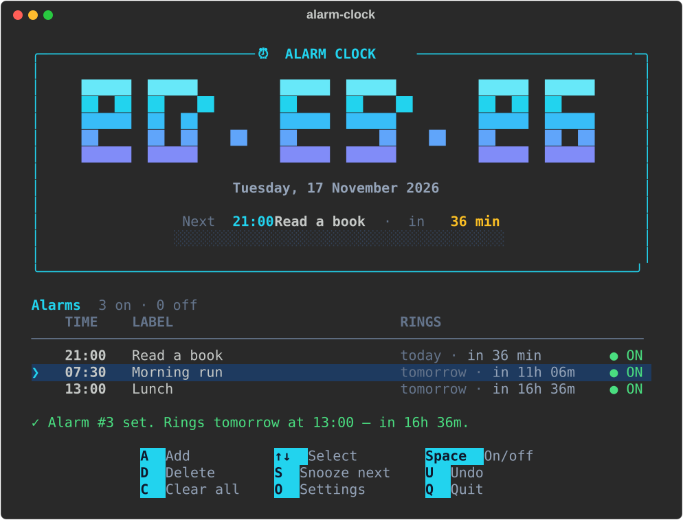
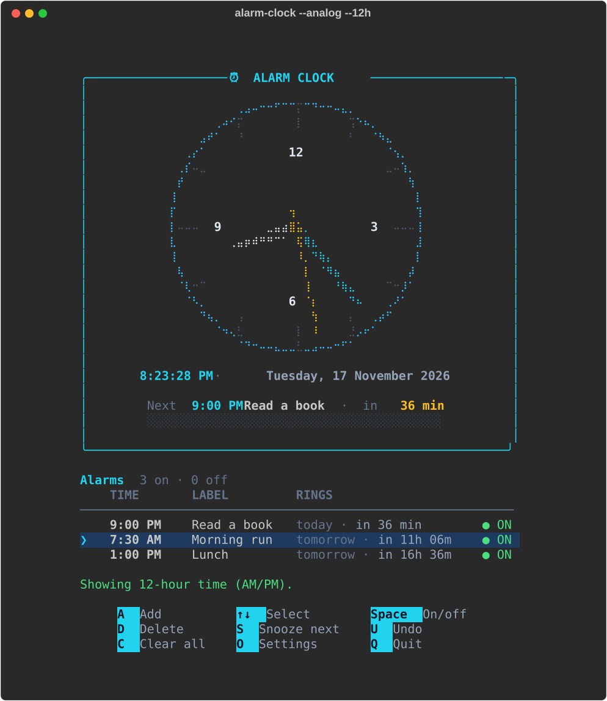

# Alarm Clock CLI

An interactive alarm clock for the terminal, with a live, colourful
display: a big digital or analog clock, a countdown to the next alarm,
and an alarm list you drive with single keypresses. It has no
dependencies beyond [Rich](https://github.com/Textualize/rich).





## Features

- **Digital or analog clock.** Big block digits, or a round face with
  hour, minute and second hands. Switch any time in Settings.
- **24-hour or 12-hour time.** Applies everywhere: the clock, the alarm
  list, the countdown and messages.
- **Add alarms in plain words.** `7:30`, `730`, `7pm`, `6:15am`, or
  `+15` for fifteen minutes from now, with a live preview of when it
  will ring.
- **Arrow-key alarm list.** Select an alarm to turn it on or off or
  delete it, and undo a delete or clear with `U`.
- **A real alarm sound.** `sound.mp3` loops until you snooze or
  dismiss, with the terminal bell as a fallback.
- **Classic mode.** A plain line-based prompt for scripts and pipes.

## Requirements

- Python 3.9+
- [Rich](https://github.com/Textualize/rich) 13+ for the terminal UI
  (installed automatically). `pytest` and `mypy` are used for
  development.
- Optionally, a command-line audio player for the alarm sound: `afplay`
  (built into macOS), or `paplay`, `ffplay`, `mpg123`, `mpv` or `aplay`
  on Linux. Without one the app falls back to the terminal bell.
- A terminal font with braille characters for the analog clock (most
  modern fonts have them).

## Setup

```bash
git clone <your-repo-url> alarm-clock
cd alarm-clock
python3 -m venv .venv
source .venv/bin/activate
pip install --upgrade pip   # older pips can't do editable installs from pyproject.toml
pip install -e ".[dev]"     # installs the `alarm-clock` command + pytest + mypy
```

For the application alone, without the development tools,
`pip install -e .` is enough.

## Running

```bash
alarm-clock
```

Or, without activating the virtual environment:

```bash
.venv/bin/alarm-clock
```

`python3 -m alarm_clock.main` does the same thing.

### Command-line options

| Option          | What it does                                                   |
| --------------- | -------------------------------------------------------------- |
| `--12h`         | Start with 12-hour time (AM/PM). The default is 24-hour.       |
| `--analog`      | Start with the analog clock face. The default is digital.      |
| `--sound FILE`  | Play a different audio file when an alarm rings.               |
| `--no-sound`    | Never play audio; use the terminal bell instead.               |
| `--classic`     | Use the plain line-based prompt instead of the live display.   |

## Keys

Everything happens on one screen.

| Key                       | Action                                                                  |
| ------------------------- | ----------------------------------------------------------------------- |
| `A`                       | Add an alarm. Type a time, press Enter, type an optional label, Enter.  |
| `↑` `↓` (or `K` `J`)      | Move the selection in the alarm list.                                   |
| `Space` (or `T`, `Enter`) | Turn the selected alarm on or off. An off alarm keeps its place.        |
| `D` (or `Backspace`)      | Delete the selected alarm.                                              |
| `U`                       | Undo the last delete or clear.                                          |
| `S`                       | Snooze the next alarm by 5 minutes.                                     |
| `C`                       | Clear every alarm (asks first, and can be undone).                      |
| `O`                       | Open Settings.                                                          |
| `H`                       | Shortcut: switch between 24-hour and 12-hour time.                      |
| `V`                       | Shortcut: switch between the digital and analog clock.                  |
| `Q`                       | Quit. Ctrl+C also works.                                                |

### Adding an alarm

Press `A` and type a time. The box shows when it will ring as you type,
e.g. "Rings today at 07:30 — in 11h 07m". It accepts:

| You type                  | Meaning                         |
| ------------------------- | ------------------------------- |
| `7:30`, `07:30`, `730`    | 07:30                           |
| `19:45`, `1945`, `19.45`  | 19:45                           |
| `7pm`, `7 PM`, `6:15am`   | 12-hour times                   |
| `+15`, `+15m`, `+2h`      | That long from now              |

Press Enter, add an optional label, and press Enter again. `Esc`
cancels at either step.

If the time has already passed today (or is the current minute), the
alarm is set for tomorrow. Two alarms can share a time; both ring.

## Settings

Press `O` to open Settings. Use `↑` `↓` to pick a setting, `←` `→` or
`Space` to change it, and `Enter` or `Esc` to close. Changes show
straight away.

| Setting     | Choices                                                                 |
| ----------- | ----------------------------------------------------------------------- |
| Time format | **24-hour** (`19:30`) or **12-hour** (`7:30 PM`)                        |
| Clock type  | **Digital** (big block digits) or **Analog** (a round face with hands)  |

The analog face shows the exact time and date underneath it, and
shrinks on a short terminal window so the alarm list still fits.

## When an alarm rings

The clock turns red, a `🔔 ALARM RINGING` banner appears, and the
alarm sound starts. Only these keys work until you answer it:

| Key                          | Action                                                                 |
| ---------------------------- | ---------------------------------------------------------------------- |
| `S`                          | Snooze 5 minutes. The alarm returns to the list marked `(snoozed ×1)`. |
| `D` (or `Enter`, `Space`)    | Dismiss: deletes the alarm.                                            |
| `Q`                          | Quit.                                                                  |

A ringing alarm keeps ringing until you answer it. Anything you were
typing, and the Settings panel, are closed so a stray keypress can't
change an alarm by accident.

## Sound

A ringing alarm plays `sound.mp3` on a loop until you snooze or
dismiss it. Short clips restart automatically, so the alarm keeps
sounding rather than playing once and going quiet.

The file is found without configuration: the working directory first,
then the installed package, then the project root. To use a different
one, or none:

```bash
alarm-clock --sound ~/Music/wake-up.wav
alarm-clock --no-sound
```

Playback shells out to whichever player is installed (`afplay` on
macOS; `paplay`, `ffplay`, `mpg123`, `mpv` or `aplay` on Linux), so
there is no audio library to install. If there is no player or no sound
file, the alarm falls back to the terminal bell (`\a`). Most terminals
ship with the bell muted or set to a silent flash, which is why a real
sound file is preferred.

## Classic mode

The original line-based prompt is still there:

```bash
alarm-clock --classic
```

```
> add 07:30 wake up
Added alarm #1 for 07:30 (wake up)
> list
  #1  07:30 today (wake up)
> start
Waiting for alarms. Press Ctrl+C to stop and return to the prompt.
```

Commands: `add HH:MM [label]`, `list`, `remove <id>`, `start`, `help`,
`quit`. **Ctrl+C** cancels the line you're typing, or stops `start`;
either way your alarms are kept. **Ctrl+D** exits.

Piping or redirecting input selects classic mode automatically, since
the live display needs a real terminal:

```bash
printf 'add 09:00 standup\nlist\nquit\n' | alarm-clock
```

## Running tests

```bash
pytest          # 297 tests
mypy            # strict type check of src/alarm_clock
```

The suite runs in well under a second, including tests that simulate an
alarm waiting 12 hours and firing, with no real delay (see
[Design notes](#design-notes)).

## Project structure

```
src/alarm_clock/
  clock.py       # Clock abstraction: SystemClock (real), FakeClock (tests)
  models.py      # Alarm dataclass + next_occurrence() time math
  scheduler.py   # In-memory alarm store, next-due lookup, deadline wait, undo
  ui.py          # Pure render functions: clock, panels, table, settings, keys
  analog.py      # Analog clock face drawn with braille characters
  timeparse.py   # Forgiving time input for the live display (7pm, 730, +15)
  sound.py       # Finds a player and a file; loops playback while ringing
  keyboard.py    # Single-keypress input with a timeout, arrow keys, UTF-8
  tui.py         # The live display: loop, modes (add, settings) and keys
  cli.py         # Classic mode: command parsing, handlers, REPL loop
  main.py        # Command-line options; picks a front end and wires it up
tests/
  test_models.py
  test_scheduler.py
  test_ui.py
  test_analog.py
  test_timeparse.py
  test_sound.py
  test_tui.py
  test_cli.py
docs/
  digital.svg    # Screenshots used in this README
  analog.svg
```

## Limitations

- **Nothing is saved.** Alarms and settings last only while the app is
  running. Use `--12h` and `--analog` to start with your preferred
  settings.
- **Alarms are one-off.** There are no repeating (daily or weekday)
  alarms; a dismissed alarm is gone.
- **The terminal must stay open.** The app is a foreground program, not
  a background service.

## Design notes

- **No persistence.** Alarms and settings exist only for the current
  process. This was an explicit choice given the "no database"
  constraint, not an oversight — see [Limitations](#limitations).
- **One injected dependency: the clock.** `AlarmScheduler` never calls
  `datetime.now()` or `time.sleep()` directly — it receives a `Clock`.
  Production uses `SystemClock`; tests use `FakeClock`, whose `sleep()`
  advances a virtual clock instead of actually waiting. This is what
  lets a test simulate an alarm firing hours later in milliseconds.
- **A fire time is resolved once, at creation.** An `Alarm` stores a
  concrete `fire_at` datetime, computed by `next_occurrence()` when the
  alarm is added and never recomputed. Deriving it repeatedly from a
  moving "now" is subtly wrong in two ways: a second alarm set for the
  same minute would be pushed a full day out the instant the first one
  fired, and an alarm whose time passed while the user was still typing
  would silently become tomorrow's alarm. `Alarm.time` is a property
  over `fire_at`, so there is only one source of truth.
- **Deadline-based waiting, not polling.** `wait_for_next()` computes
  the seconds remaining until the deadline and makes a single
  `clock.sleep(seconds)` call. It sleeps again only if that call came
  back early — `time.sleep` can be cut short by a signal, and ringing an
  alarm ahead of time is worse than sleeping twice. Sub-millisecond
  remainders count as arrival, and a clock that fails to advance at all
  raises `ClockError` rather than spinning forever.
- **CLI is a thin shell.** `cli.py` never touches time directly; it
  only calls into `AlarmScheduler`, which is what keeps the scheduling
  logic testable independent of any I/O.
- **Integer ids, not time-based identity.** Two alarms can share the
  same `HH:MM`, so alarm identity is an auto-incrementing counter
  assigned by the scheduler, not the time value itself. Ties in firing
  order are broken by id, so equal-time alarms fire in the order added.
- **Ctrl+C never destroys state.** At the prompt it abandons the
  half-typed line; during `start` it stops waiting; in the live display
  it quits cleanly, restoring the terminal. Neither discards alarms.
- **Rendering is pure.** Every function in `ui.py` takes state and
  returns a Rich renderable — no I/O, no clock access. That is what
  lets the whole look of the app be asserted against a recording
  console in `test_ui.py`, rather than eyeballed.
- **Polling in the UI, sleeping in the scheduler.** The live display
  can't block in `wait_for_next()` — it has to redraw and read keys —
  so the scheduler also exposes `due_now()`, a non-blocking "what has
  arrived?" query. Classic mode keeps the sleeping path. Both read the
  same `fire_at` field, so they can't disagree about when an alarm is
  due.
- **A ringing alarm is not auto-removed.** `due_now()` reports; only
  the user's snooze or dismiss mutates. An alarm you slept through is
  still there when you come back.
- **The big clock is centred as a block, not line by line.** Rich
  strips trailing whitespace from a line before applying `justify`, and
  some glyph rows end in a space. Centring each row individually
  therefore shifted exactly those rows left, visibly distorting the
  clock as the digits changed.
  `big_text` returns an unjustified block and the caller wraps it in
  `Align.center`, which pads every row equally. `test_ui.py` checks all
  sixty seconds.
- **Sound is a subprocess, not a dependency.** Playing audio portably
  from Python means a native extension or a large library; shelling out
  to a player that is already installed costs one `shutil.which` call
  and degrades cleanly to the terminal bell. The clip is restarted when
  it ends, which is what makes a seven-second file ring continuously,
  and stopped on the keypress rather than on the next frame so
  dismissing feels immediate.
- **cbreak, not raw, terminal mode.** Keys arrive unbuffered, but
  Ctrl+C still raises `SIGINT`, so the standard way out of a terminal
  program keeps working.
- **The terminal is checked, not assumed.** `main.py` falls back to the
  classic prompt when stdin isn't a tty, so piping into the app gives
  readable output instead of escape codes.
- **Square pixels for the big digits.** Terminal cells are about twice
  as tall as they are wide, so each pixel of the seven-segment font is
  drawn two cells wide. The clock falls back to the compact one-cell
  font when the window is too narrow.
- **The analog face is braille.** Each braille character is a 2×4 grid
  of dots, which gives four times the resolution of whole cells and
  roughly square dots. Hands and ticks are drawn as dots on a canvas
  with a layer each, and a cell takes the colour of its top layer, so
  the second hand stays visible where it crosses the others.
- **No typing ids, no leaving the screen.** Alarms are picked with the
  arrow keys, and questions ("what time?") are typed into an inline box
  that previews the result live. Prompts that dropped out of the live
  display were the biggest friction in the first version.
- **Deletes can be undone.** Delete and Clear all act straight away
  (no "are you sure?" for a single alarm) and `U` brings them back,
  which is faster and safer than a confirmation you learn to click
  through.

